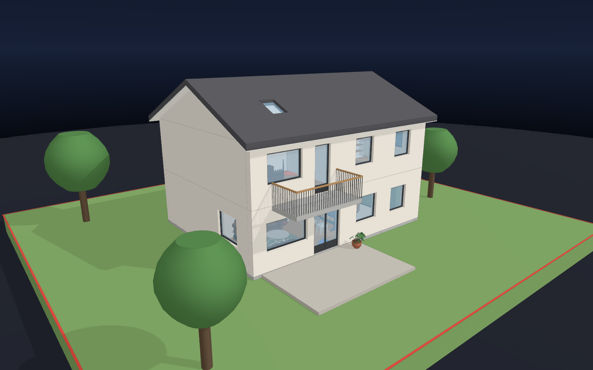
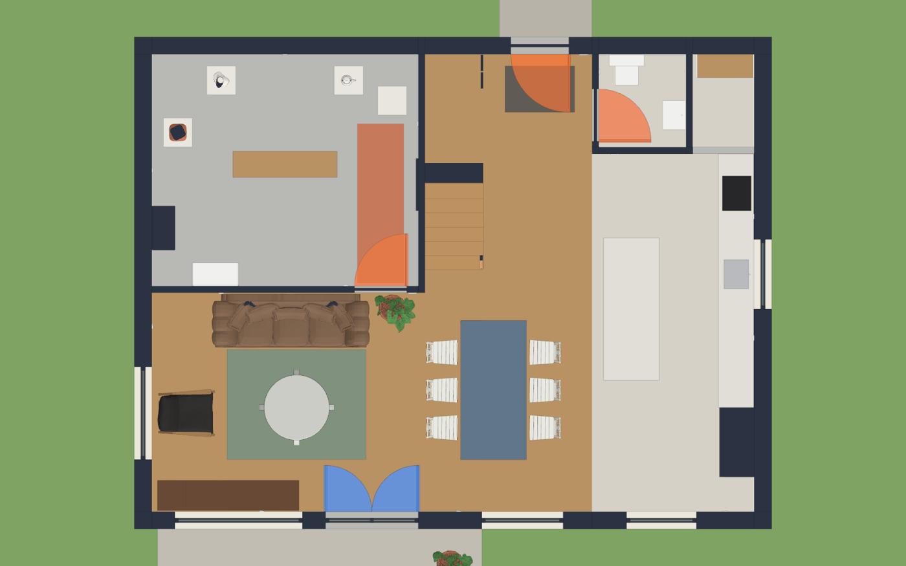
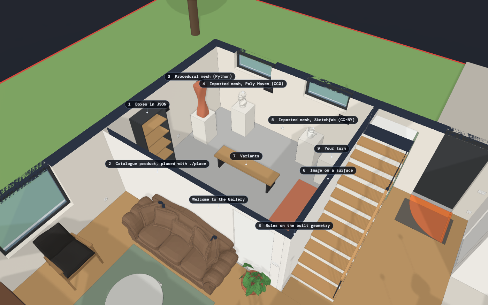
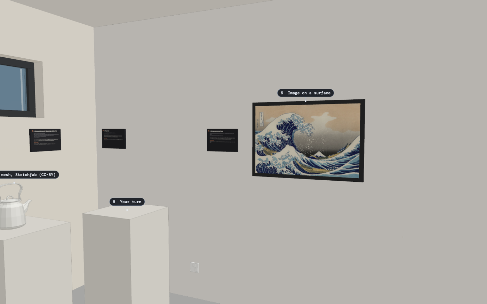
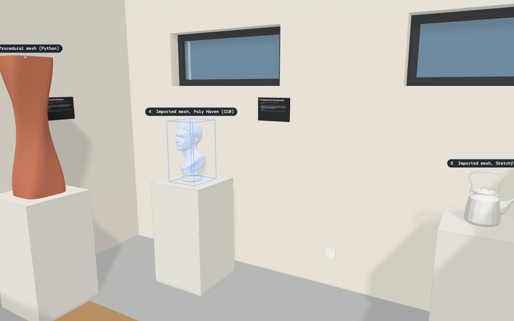
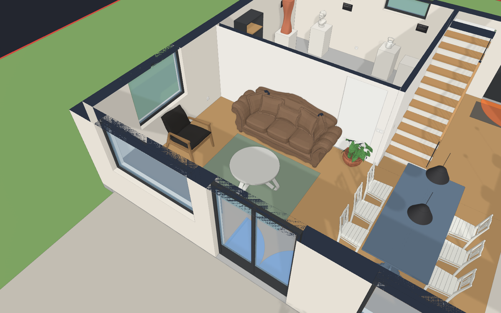
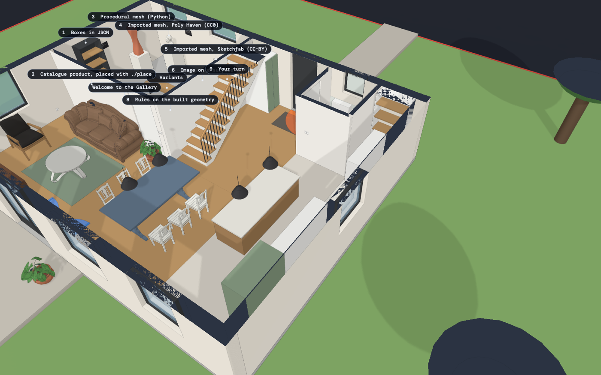

<p align="center">
  
</p>

<h1 align="center">Monarch</h1>

<p align="center"><strong>Your house as JSON. Your AI agent as the draughtsman. A real IFC out.</strong></p>

<p align="center">
  
  
  
  
  
</p>

Monarch is a house model that a coding agent can edit precisely. Walls, openings, slabs,
stairs, roofs, furniture and products are plain JSON files in metres. One command compiles
them into an IFC4 file that any BIM tool opens, tessellates it once, exports glTF and
serves a hot-reloading browser viewer. A query tool answers geometric questions from the
built geometry, so the agent never guesses a distance. Declarative rules fail the build when
a walkway is blocked. Every object carries its provenance.

It was born while an engineer modelled his own family's house, then under construction,
together with Claude Code over hundreds of commits. An architect who saw the result said he
knew no software as good. This repository is that engine, with the private house replaced by
**Casa Monarch**, a fictional two-storey home whose ground-floor gallery is the tutorial.

## 60-second quickstart

You need [uv](https://docs.astral.sh/uv/getting-started/installation/) and a browser.

```sh
git clone https://github.com/bersling/monarch-oss && cd monarch-oss
uv sync
./open.sh
```

`./open.sh` builds the house and opens the viewer. Edit anything under `data/` and save: the
server rebuilds and the open tab swaps the model in place, keeping your camera. The IFC is at
`generated/casa_monarch.ifc`.

Without a browser, `./build.sh` is the whole pipeline. On this machine it takes about two
seconds, checks included:

```
$ ./build.sh
Wrote generated/casa_monarch.ifc (Casa Monarch) — GF Ground floor: 9 walls, 9 windows; UF Upper floor: 12 walls, 8 windows; Site: 32 terrain tris, 1 boundary lines, 2 site slabs, 5 site objects
geometry cache: 216 elements (0 re-meshed, 216 reused), 62276 verts, 77443 tris, 0.5s
model.glb: 216 nodes, 2.9 MB, 0.0s
ok     0.0s  variant.py check
ok     0.0s  products.py check
ok     0.1s  check_model.py
ok     0.0s  rules.py
4/4 checks passed in 0.1s
```

Optional: [Blender](https://www.blender.org/) to convert downloaded meshes
(`src/convert_asset.py`), Google Chrome for headless screenshots (`src/snap_web.py`). Both
paths are macOS constants at the top of those two files; other platforms change one line.
Casa Monarch builds without either.

## Talk to your house

Open the repository in Claude Code (or any coding agent that reads `CLAUDE.md` /
`AGENTS.md`) and type a sentence. These three are printed on plaques in the gallery, and
each one works here.

| You say | What the agent does |
|---|---|
| *Switch the gallery centre to the sculpture variant* | Runs `src/variant.py load gallery_centre sculpture`, which swaps the `GAL_CENTRE_*` entries in `data/ground_floor.json` and rebuilds. The bench becomes a terracotta sphere stack; the viewer tab updates. |
| *Add a clear rule that keeps 90 cm in front of the bedroom wardrobe free* | Asks `./q show BED_WARDROBE` for the real bounds, writes a `clear` rule into `data/rules/bedroom.json`, runs `./build.sh`. From now on anything placed in that strip fails the build. |
| *Find a CC0 plant on Poly Haven and put it on the empty plinth in the gallery* | `src/find_asset.py "plant"` lists candidates with licence and real size, `src/convert_asset.py` turns the glTF into a metre-scaled OBJ, the agent places it with `mesh`/`at` on `GAL_PLINTH_EMPTY`, copies `MeshSource`/`MeshLicense`/`MeshURL`/`MeshAuthor` into the props, builds, and renders a screenshot to check its own work. |

The loop the agent follows is five steps, written down in [`CLAUDE.md`](CLAUDE.md): measure
with `./q`, edit JSON, `./build.sh`, verify the numbers with `./q`, look at a render.

## Why JSON + IFC

Revit, ArchiCAD, SketchUp and Blender are superb tools for people. For an agent they are
opaque: binary files, GUI-driven edits, no diff, no way to ask "how far is the sofa from the
wall" from a shell. Monarch keeps the authoring layer in text and the deliverable in the
open standard:

- **Diffable.** A moved wardrobe is a two-line change in a pull request.
- **Measurable.** `./q at 2.5,6.0 --storey GF` answers from the built geometry, not from a
  sketch.
- **Verifiable.** Rules run on the actual IFC on every build; a 5 mm penetration is a failed
  check, not a surprise on site.
- **Portable.** The output is IFC4 (`FILE_SCHEMA(('IFC4'))`), written with
  [IfcOpenShell](https://ifcopenshell.org/) 0.8.5. Open it in BlenderBIM, Solibri, Revit, or
  the hosted viewer below.

<p align="center">
  
  <br><sub>Ground floor, plan view (<code>P</code> in the viewer). Gallery top left, living and dining below it, kitchen on the right, guest WC and hall at the top.</sub>
</p>

## The house is the tutorial

<p align="center">
  
</p>

Room GF.06 of Casa Monarch is a gallery with one exhibit per way of getting an object into
the model. Each exhibit carries a `Pset_Gallery` property set (Title, Provenance, License,
HowTo, Prompt), so any IFC viewer shows the lesson on click, and a plaque on the wall
repeats it. All texts live in [`data/gallery.json`](data/gallery.json).

| # | Exhibit | What it teaches | Prompt on the plaque |
|---|---|---|---|
| 1 | Bookshelf `GAL_SHELF` | Furniture as `parts[].boxes` in the storey JSON; `Dimensions` is checked against the geometry; a `bbox` rule pins the size | Add a 0.8 x 0.4 x 2.0 m bookshelf with five shelves on the north wall of the study |
| 2 | `CAT_GALLERY_SHELF` | A catalogue product in `data/products/`, placed with `./place`; the instance lives in `data/placements.json` | Place a second demo-bookshelf in the living room with ./place |
| 3 | Twisted column `GAL_PROCEDURAL` | A mesh generated by Python (`twist_column()` in `src/gen_assets.py`), referenced with `mesh`/`at`/`rotation_z` | Generate a 0.5 m tall spiral vase with src/gen_assets.py and put it on the sideboard in the living room |
| 4 | Marble bust `GAL_BUST` | A Poly Haven CC0 mesh found with `src/find_asset.py`, converted with `src/convert_asset.py`; the licence travels in the IFC props | Find a CC0 vase on Poly Haven and place it on the dining table |
| 5 | Teapot `GAL_TEAPOT` | A Sketchfab CC-BY mesh: same pipeline plus the attribution string on the plaque, in `assets/README.md` and in the `Attribution` prop | Find a CC-BY teapot on Sketchfab, convert it with src/convert_asset.py and credit the author in the props |
| 6 | Framed print `GAL_PICTURE` | A part with `texture {image, u_axis, v_axis}` projects a JPEG onto a box; the IFC stores real UVs | Hang a 60 x 41 cm print of assets/picture_great_wave.jpg above the bed |
| 7 | Centre piece `GAL_CENTRE_*` | Variants: a group owns a set of ids; `src/variant.py load` swaps them and rebuilds | Switch the gallery centre to the sculpture variant |
| 8 | Walkway `FLOOR_GF_WALKWAY_MARK` | Rules on the built geometry: a `clear` rule fails the build when anything enters the terracotta strip | Add a clear rule that keeps 90 cm in front of the bedroom wardrobe free |
| 9 | Empty plinth `GAL_PLINTH_EMPTY` | Your turn | Find a CC0 plant on Poly Haven and put it on the empty plinth in the gallery |

<p align="center">
  
  <br><sub>Exhibit 6: a public-domain JPEG projected onto a box with real UV coordinates in the IFC. Exhibit 9 waits on the left.</sub>
</p>

More in [`docs/gallery.md`](docs/gallery.md).

## What's in the box

```
data/house.json                      project name, IFC path, storey list (code, name, elevation, file), site
data/*.json, assets/*.obj            source of truth: metres, local frame, sourced props
  │  src/build_model.py              JSON -> IFC. Only engine code lives in src/; rooms are data
  ▼                                  (JSON + rules), not scripts
generated/<house>.ifc                the deliverable for architects and BIM tools
  │  src/geometry_cache.py           tessellated ONCE per build; products whose geometry key is
  ▼                                  unchanged are reused
generated/geometry.npz + elements.json  meshes + bounds + property sets + house summary per element
  ├─► src/export_glb.py  -> generated/model.glb -> web/ (three.js) browser viewer
  ├─► src/q.py (./q)     answers questions about the actual geometry
  ├─► src/rules.py       declarative data/rules/*.json on the actual geometry
  └─► src/run_checks.py  all checks in one process, create_shape served from the cache
```

| What | Command |
|---|---|
| Build + verify everything | `./build.sh` |
| Checks only / matching ones | `./check.sh` / `./check.sh rules` |
| Viewer with hot reload | `./open.sh` |
| Wait for the viewer's build + checks (agents) | `./open.sh --no-browser --wait` |
| Screenshots with the viewer's renderer | `.venv/bin/python src/snap_web.py room=GAL_ plan=GF` |
| Ask the model | `./q help` |
| Storeys of this house | `./q storeys` |
| Room cards | `./q room`, `./room sketch\|check\|snap <room>` |
| Catalogue products | `./place list\|show\|add\|move\|remove\|check` |
| Variants | `.venv/bin/python src/variant.py list\|show\|load\|save\|check` |
| Unit tests | `.venv/bin/python -m unittest discover -s tests` |
| Browser regression | `node tests/browser_viewer.mjs <viewer URL>` |

The viewer (`web/`, three.js, no build step) has Look and Orbit modes, WASD flight, storey
toggles, section cuts, a plan view, a millimetre measuring tool with corner and edge
snapping, a property panel with every pset, search, shareable URL hashes and **Plaques**:
floating labels on every element with a `Pset_Gallery`. Details in
[`docs/viewer.md`](docs/viewer.md).

<p align="center">
  
  <br><sub>A headless screenshot made by <code>src/snap_web.py ... sel=GAL_BUST</code>: the selection box on exhibit 4. The same renderer the user sees, so the agent can check its own work.</sub>
</p>

## Ask instead of guessing

`./q` reads `generated/geometry.npz`, the tessellation of the actual IFC. Output below is
pasted from this repository.

```
$ ./q at 2.5,6.0 --storey GF
(z = GF floor + 1.00 m = 1.000)
room: GALLERY (Gallery (tutorial room))
inside: nothing (free air)
  +x    2.400 m to W_GAL_E (IfcWallStandardCase) surface at x = 4.900
  -x    2.200 m to W_W@GF (IfcWallStandardCase) surface at x = 0.300
  +y    2.200 m to W_N@GF (IfcWallStandardCase) surface at y = 8.200
  -y    1.800 m to W_GAL_S (IfcWallStandardCase) surface at y = 4.200
  down  1.000 m to FLOOR_GF_GALLERY (IfcCovering) surface at z = 0.000
  up    1.650 m to SLAB_UF (IfcSlab) surface at z = 2.650
```

```
$ ./q near GAL_PLINTH_EMPTY
GAL_PLINTH_EMPTY  x 4.200..4.700  y 7.150..7.650  z 0.000..0.900
  FLOOR_GF_OAK                       IfcCovering            -z gap 0.0 cm
  FLOOR_GF_GALLERY                   IfcCovering            -z gap 0.0 cm
  SLAB_GF                            IfcSlab                -z gap 0.0 cm
  FLOOR_GF_WALKWAY_MARK              IfcCovering            -y gap 15.0 cm
  W_GAL_E                            IfcWallStandardCase    +x gap 20.0 cm
  OUT_GAL_E                          IfcOutlet              +x gap 18.4 cm, -y gap 10.6 cm
  GAL_PLINTH_5                       IfcFurnishingElement   -x gap 25.0 cm
  STAIR_GF_UF                        IfcStairFlight         +x gap 32.0 cm
  HALL_WARDROBE                      IfcFurnishingElement   +x gap 32.0 cm
  GAL_TEAPOT                         IfcFurnishingElement   -x gap 37.0 cm, +y gap 0.7 cm, +z gap 0.0 cm
10 within 0.5 m (bounding boxes; ./q clash GAL_PLINTH_EMPTY for actual penetrations)
```

```
$ ./q fits GAL_SHELF --at 4.0,5.0
GAL_SHELF moved by 370.0 cm, 20.0 cm, 0.0 cm -> x 4.000..4.400  y 5.000..5.800  z 0.000..2.000
FITS (actual meshes, 5 mm tolerance)

$ ./q free 3.9,4.3,0,4.6,6.9,2.0
box x 3.900..4.600  y 4.300..6.900  z 0.000..2.000
  blocked by FLOOR_GF_WALKWAY_MARK              IfcCovering            overlap of bounds 70.0 cm x 260.0 cm x 0.2 cm

$ ./q clash GAL_BUST
no penetrations above 0.5 cm
```

`./q show ID` prints bounds, size, every property set and the `data/` file plus JSON path
that defines the element, so the agent knows where to edit. `./q find TEXT` searches keys,
product names and classes. `./q storeys` lists the storeys from `data/house.json`.

## Rules are data

A constraint that must hold forever is a few lines of JSON, not a script. This is
[`data/rules/gallery.json`](data/rules/gallery.json), guarding the terracotta walkway of
exhibit 8:

```json
{
  "id": "gallery-walkway-clear",
  "rule": "clear",
  "why": "The marked walkway from the gallery door to the picture wall must stay free of furniture and plinths.",
  "zone": [3.85, 4.25, 0.0, 4.65, 7.0, 2.1],
  "except": ["FLOOR_GF_WALKWAY_MARK"]
}
```

Move the empty plinth 20 cm south (`y 7.15 -> 6.95` in `data/ground_floor.json`) and build:

```
$ ./build.sh
...
ok     0.1s  check_model.py
FAIL   0.0s  rules.py
     | FAIL  gallery:gallery-walkway-clear  GAL_PLINTH_EMPTY enters the zone (0.450 x 0.050 x 0.900 m overlap of bounds)
     | rules: 5 evaluated, 1 failing, 0 warning
3/4 checks passed in 0.1s; FAILED: rules.py
```

Rule kinds (`src/rules.py`): `clear`, `bbox`, `inside`, `gap`, `ray` and `no_penetration`.
The house-wide `no_penetration` rule in `data/rules/house.json` catches furniture poking
into walls, slabs or stairs beyond 5 mm; a pre-existing overlap can be listed as
`UNREVIEWED` and stays a warning while any new one fails. `src/check_model.py` adds the
generic invariants over the JSON itself: unique ids, door swings, roof headroom, fixtures on
real wall faces, `Dimensions` versus geometry, metadata presence.

## Variants

A room can hold several layouts. A group in `data/variants.json` owns a set of ids; each
variant is a file in the storey schema.

```
$ .venv/bin/python src/variant.py list
gallery_centre  (target: ground_floor.json)  — Centre piece of the gallery (exhibit 7).
  * bench: Oak bench 180 x 45 cm to sit and look at the exhibits.
    sculpture: Terracotta sphere stack, JSON primitives only.

$ .venv/bin/python src/variant.py load gallery_centre sculpture
...
loaded gallery_centre/sculpture into data/ground_floor.json — rebuilding IFC…
```

`save` captures hand edits back into the variant file, and `check` (part of every build)
fails when the storey JSON drifted from the saved active variant.

## Products

Reusable geometry is defined once in `data/products/<id>.json` in its own local frame and
placed as many times as you like:

```
$ ./place list
demo-bookshelf · Demo bookshelf 80 x 40 x 120 · 80 x 40 x 120 cm · data/products/demo-bookshelf.json

$ ./place add demo-bookshelf CAT_LIVING_SHELF --storey GF --at 0.3,0.3,0 --rotation 0 --status Proposed
```

Placements live in `data/placements.json`, are merged into the storey at build time and
survive variant reloads and room regeneration. `./place check` runs with every build.

## Bring your own geometry

Four ways, all shown in the gallery:

1. **Boxes, cylinders, spheres, prisms** in JSON. Fastest and lightest; most furniture needs
   nothing else. One physical thing is one entry with styled `parts`.
2. **Procedural meshes** from Python: `src/gen_assets.py` writes OBJ files (the twisted
   column, a pendant lamp, a bush) that the JSON references with `mesh`, `at`,
   `rotation_z`.
3. **Imported meshes.** `src/find_asset.py "sofa"` searches Poly Haven (CC0, real scale)
   and, with a token, Sketchfab (mostly CC-BY). `src/convert_asset.py` runs headless Blender
   to produce a triangulated, metre-scaled, Z-up OBJ with the origin where the placement
   convention wants it. Without Blender, `src/dae_to_obj.py` handles Collada in pure Python.
4. **Images on surfaces.** A part with `texture {image, u_axis, v_axis}` projects a JPEG or
   PNG onto a box; the IFC stores standard `IfcImageTexture` records with real UVs, and the
   GLB embeds the image.

Licences are not optional here. Every mesh in `assets/` is CC0 or CC-BY, with author, source
URL and licence recorded in [`assets/README.md`](assets/README.md) and in the element's
props (`MeshSource`, `MeshLicense`, `MeshURL`, `MeshAuthor`, plus `Attribution` for
CC-BY). Nothing from 3D Warehouse or of unknown origin ships in this repository.

<p align="center">
  
  <br><sub>Living and dining: the sofa, armchair, coffee table, dining table and chairs are Poly Haven CC0 meshes; the pendant lamps are procedural; the rug and sideboard are JSON boxes.</sub>
</p>

## Hosted viewer

[`site/`](site/) is a static page that opens any `.ifc` in the browser: drop a file, it is
parsed client-side with [web-ifc](https://github.com/ThatOpen/engine_web-ifc) 0.0.78
(WebAssembly) and drawn with three.js. Nothing is uploaded; there is no server. Storey chips,
click-to-select with every property set, search, plaques, orbit and WASD flight. A GitHub
Pages workflow (`.github/workflows/pages.yml`) builds Casa Monarch on every push and
publishes it next to the page, so a visitor can press "Load the example house".

Once published, the page will live at `https://bersling.github.io/monarch-oss/`. Locally:

```sh
cp generated/casa_monarch.ifc site/ && python3 -m http.server 8080 -d site
```

## Use it for your own house

1. Fork or copy the repository. Keep `src/`, `web/`, `tests/`; replace `data/` and `assets/`.
2. Edit `data/house.json`: name, IFC path, storeys with their elevations and files.
3. Measure from your plans. Write exterior walls, interior walls, openings and slabs into
   the storey files in metres, origin at a corner you can find on every drawing
   ([`docs/data-format.md`](docs/data-format.md) lists every section with an example).
4. Let the agent do the rest: `./open.sh`, then "add the kitchen from the joiner's drawing
   on page 3". It measures with `./q`, edits, builds, checks and renders.
5. Put the constraints you care about into `data/rules/`, the layouts you are still
   deciding between into `data/variants/`.

Tip: if you register your plan PDFs in `data/plan_documents.json`, `./q compare GF`
overlays the built IFC section on the drawing and `./q sources` lists the documents with
their printed date and verification status. Casa Monarch, being fictional, registers none.

<p align="center">
  
  <br><sub>The ground floor with the upper storey cut away. The kitchen island keeps 1.0 m from the run because <code>data/rules/kitchen.json</code> says so.</sub>
</p>

## Architecture decisions

[`docs/architecture.md`](docs/architecture.md) explains the pipeline, why IFC is the export
and never the runtime format, why the tessellation is cached per element, how the viewer
guarantees that geometry and properties carry the same IFC digest, and the invariants the
tools rely on. [`docs/data-format.md`](docs/data-format.md) is the schema reference,
[`docs/viewer.md`](docs/viewer.md) the viewer manual, [`docs/gallery.md`](docs/gallery.md)
the tutorial room.

The dependency list is short on purpose: `ifcopenshell`, `pymupdf` (plaque textures and
plan overlays), `shapely`. The viewers vendor three.js r170 and web-ifc 0.0.78; no npm, no
bundler.

## Contributing

Pull requests are welcome. [`CONTRIBUTING.md`](CONTRIBUTING.md) covers worktrees, the
test suite, how to add a rule instead of a check script, the metadata convention, and the
licence requirements for assets. A good first contribution is exhibit 9.

## Licence and attributions

Code and project data are MIT, see [`LICENSE`](LICENSE). Casa Monarch is fictional: its
suppliers, contracts and `example.com` URLs are placeholders, not real companies. The mesh
and image provenance is real and listed in [`assets/README.md`](assets/README.md): Poly
Haven models by Fran Calvente, Vibrant Nordic, Kirill Sannikov, Kuutti Siitonen, Yann
Kervran, Rico Cilliers, Patrik Pangerl and Ulan Cabanilla (CC0 1.0); "Old Soviet teapot"
by [Amagitsune](https://sketchfab.com/Amagitsune) (CC BY 4.0); "The Great Wave off
Kanagawa" by Katsushika Hokusai (public domain, via Wikimedia Commons). The hosted viewer
ships web-ifc (MPL-2.0) and three.js (MIT).
